# Learn — plateforme de cours en ligne

Cours vidéo, chapitres, quiz, progression, certificats vérifiables et gamification (XP, niveaux, séries de jours, badges, classement). Interface en français, sobre et professionnelle, pensée pour apprendre à son rythme.

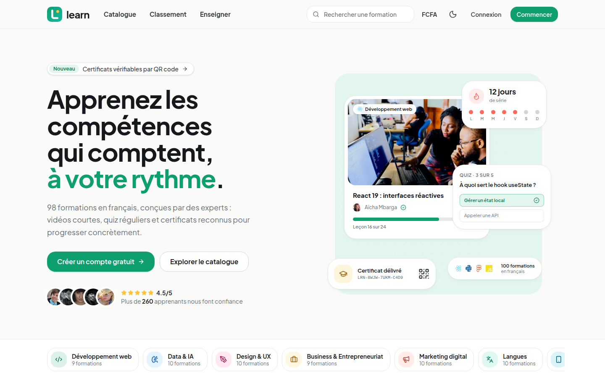

## Aperçu

### Un tableau de bord qui donne envie de revenir

Série de jours, niveau et XP, objectif quotidien, reprise de la formation en cours en un clic et ligue hebdomadaire.

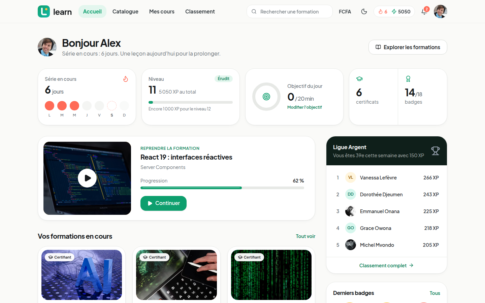

<table>
  <tr>
    <td width="50%">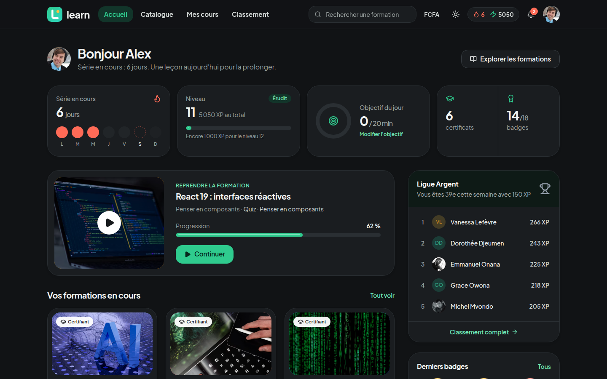<p align="center"><sub>Thème sombre natif</sub></p></td>
    <td width="50%">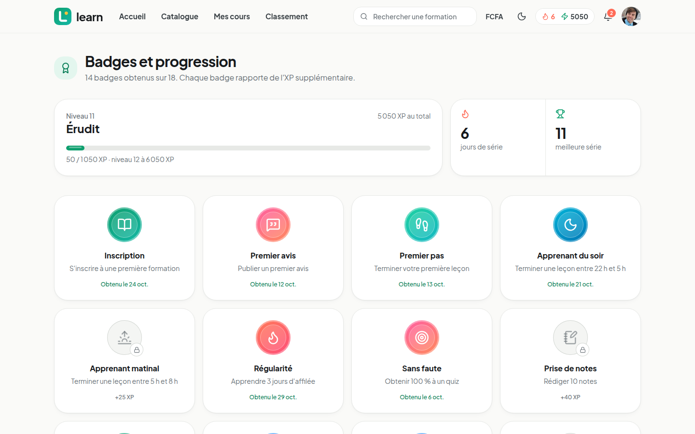<p align="center"><sub>18 badges à débloquer, chacun rapporte de l'XP</sub></p></td>
  </tr>
</table>

### Trouver la bonne formation

<table>
  <tr>
    <td width="50%">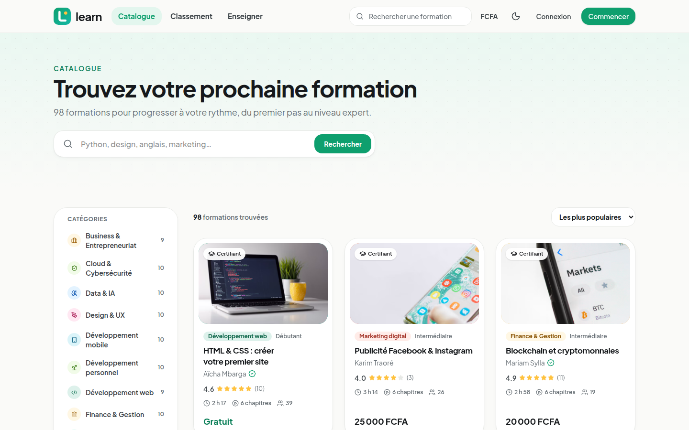<p align="center"><sub>Catalogue : recherche, catégories, filtres et tri</sub></p></td>
    <td width="50%">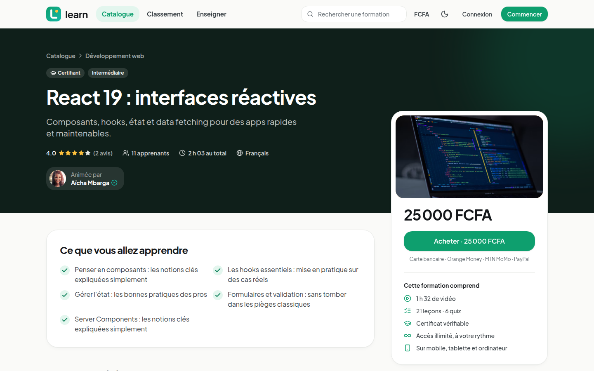<p align="center"><sub>Page formation : programme, avis, formateur, paiement</sub></p></td>
  </tr>
</table>

### Apprendre, puis vérifier ce qu'on a retenu

<table>
  <tr>
    <td width="50%">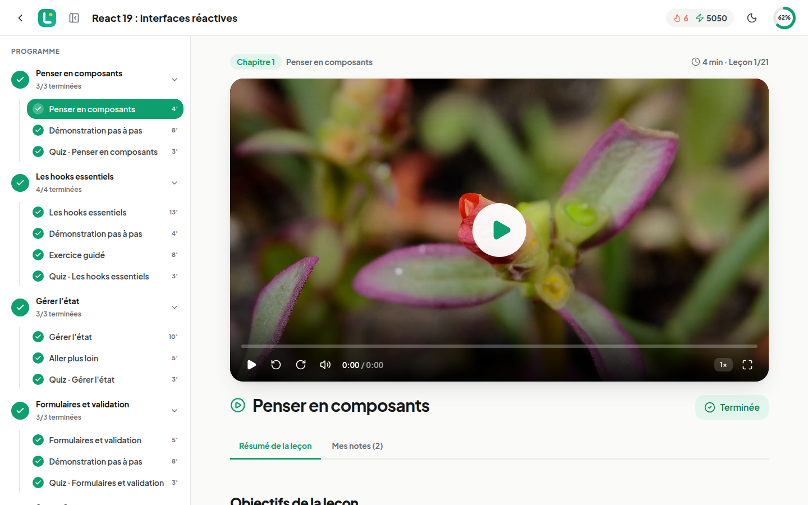<p align="center"><sub>Lecteur immersif : programme, vidéo, résumé et notes horodatées</sub></p></td>
    <td width="50%">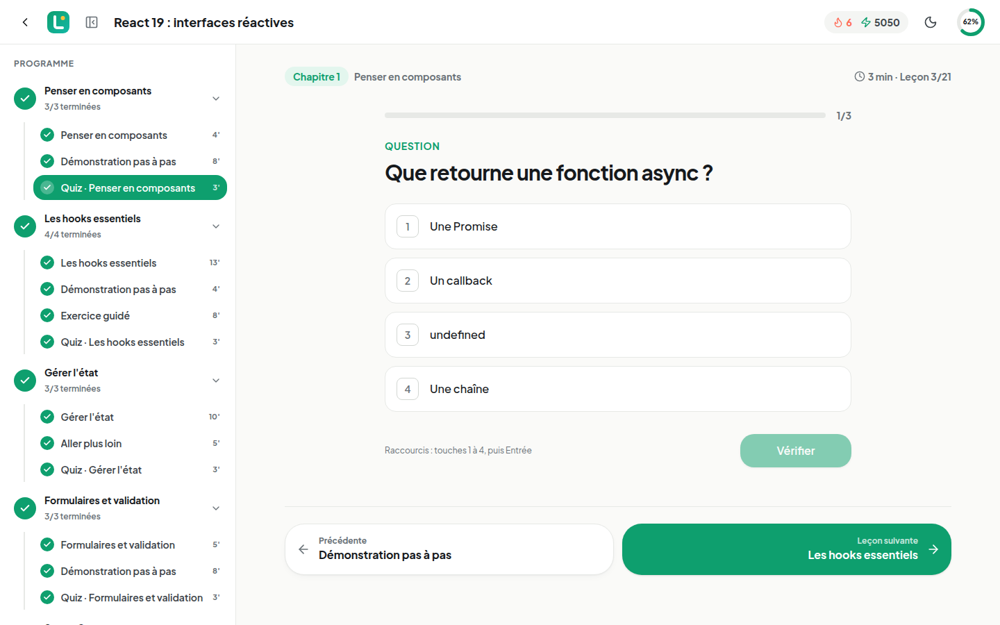<p align="center"><sub>Quiz de fin de chapitre, utilisable au clavier</sub></p></td>
  </tr>
</table>

### Des certificats qui se vérifient

Chaque certificat porte un code unique et un QR code menant à une page publique de vérification. Export PDF et ajout à LinkedIn en un clic.

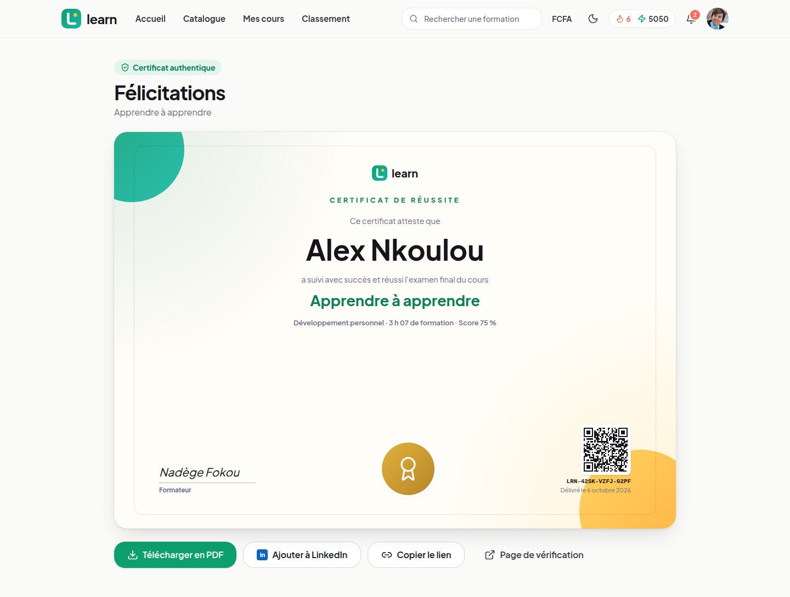

<table>
  <tr>
    <td width="50%"><p align="center"><sub>Tous les certificats obtenus</sub></p></td>
    <td width="50%">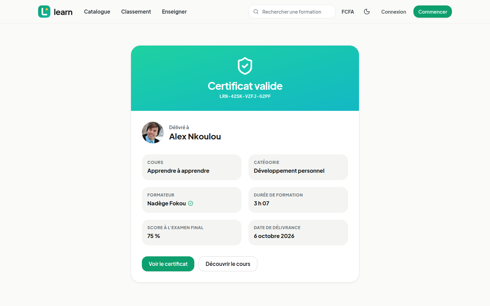<p align="center"><sub>Page publique <code>/verify/&lt;code&gt;</code></sub></p></td>
  </tr>
</table>

### Classement et émulation

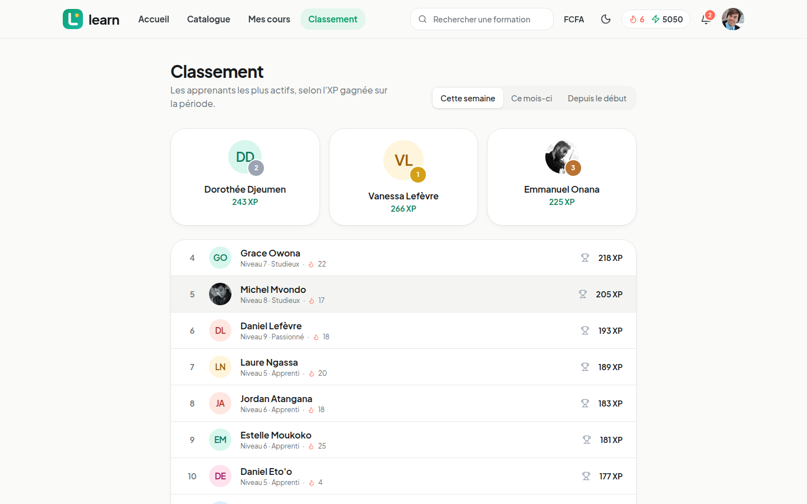

### Pensé pour le mobile

<p align="center">
  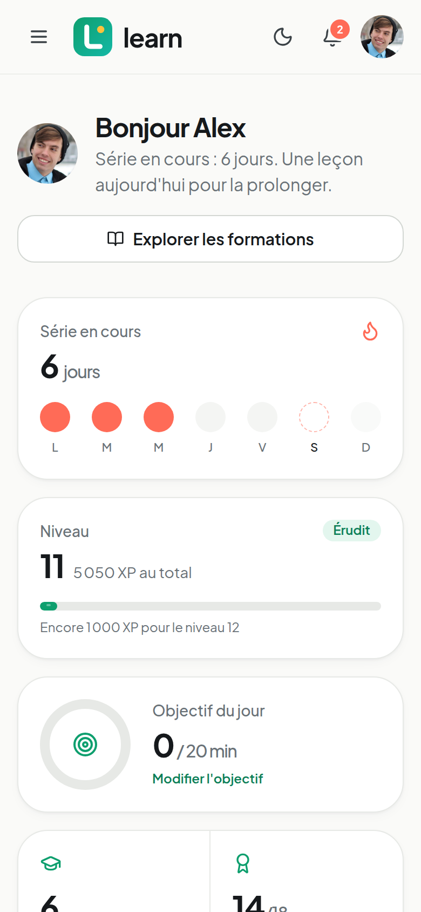
  &nbsp;&nbsp;
  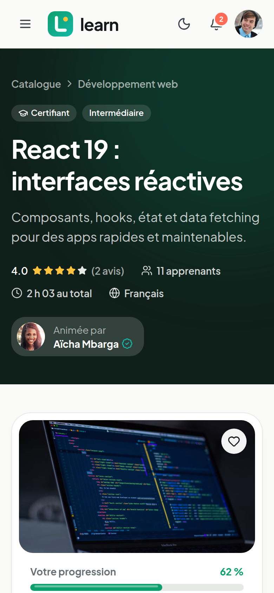
</p>

### Côté formateurs et administration

<table>
  <tr>
    <td width="50%">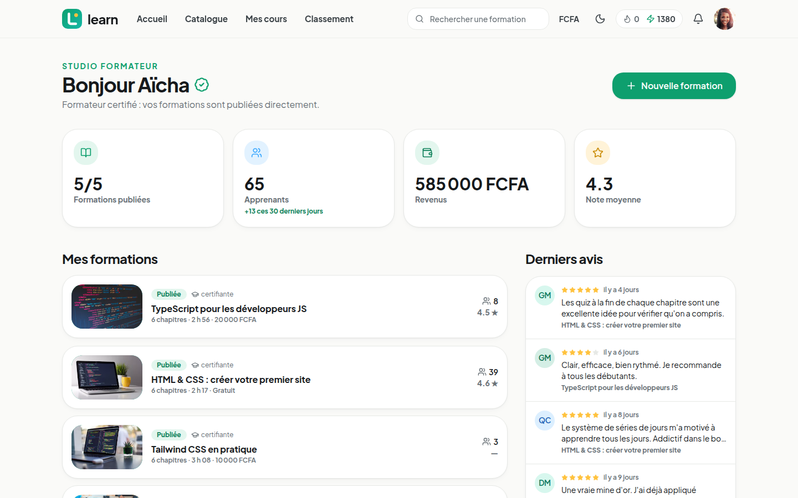<p align="center"><sub>Studio formateur : formations, apprenants, revenus, avis</sub></p></td>
    <td width="50%">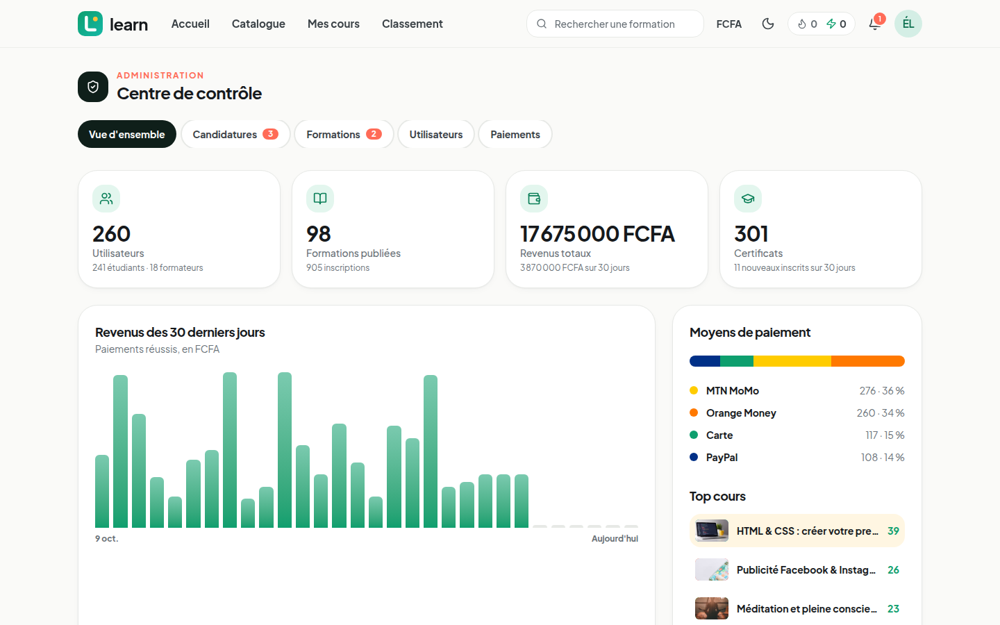<p align="center"><sub>Administration : revenus, moyens de paiement, modération</sub></p></td>
  </tr>
</table>

## Démarrage rapide

Prérequis : Node.js 20+, Docker.

```bash
npm install
npm run setup      # lance PostgreSQL (Docker, port 5440), crée le schéma et charge les données de démo
npm run dev        # http://localhost:3000
```

Pour une version rapide, comme en production :

```bash
npm run build && npm start
```

## Comptes de démo

Mot de passe commun : `Learn2026!` (boutons de remplissage rapide sur la page de connexion)

| Rôle | Email | Ce qu'on peut tester |
|---|---|---|
| Étudiant | `etudiant@learn.dev` | Tableau de bord, 11 formations dont 7 terminées, 6 certificats, 14 badges, notes |
| Formateur certifié | `formateur@learn.dev` | Studio : créer et éditer des cours, chapitres, leçons, quiz, examen final, publication |
| Admin | `admin@learn.dev` | Statistiques, validation des candidatures formateur et des cours, utilisateurs, paiements |

Paiement simulé :
- **Carte** : `4242 4242 4242 4242` est acceptée, une carte se terminant par `0002` est refusée.
- **Mobile Money** (MTN MoMo, Orange Money) : n'importe quel numéro à 9 chiffres commençant par 6.

## Fonctionnalités

- **Catalogue** : 100 cours de démo dans 10 catégories, recherche, filtres (catégorie, niveau, prix, durée, certifiant, note), tri, pagination.
- **Page cours** : programme détaillé, aperçus vidéo gratuits, planificateur de temps estimé (minutes par jour → date de fin), avis, formateur.
- **Apprentissage** : lecteur vidéo maison (vitesse, raccourcis clavier, reprise, validation automatique à 90 %), leçons écrites, notes horodatées, quiz de chapitre avec correction immédiate (rappel actif), examen final.
- **Certificats** : délivrés à 100 % de progression + examen final ≥ 70 %. Export PDF avec QR code, page publique `/verify/<code>`, ajout à LinkedIn.
- **Gamification** : XP, niveaux et titres, objectif quotidien, séries de jours, 18 badges, ligues hebdomadaires, classement (semaine, mois, depuis le début). Retours discrets par notifications, sans animation envahissante.
- **Paiement simulé** : multi-devises (FCFA, €, $), carte, MTN MoMo, Orange Money, PayPal ; reçus dans le profil.
- **Profil** : photo de profil (initiales en repli), bio, objectif quotidien, devise, thème clair/sombre/système, couleur d'accent (8 palettes, vert émeraude par défaut, appliquée jusqu'aux certificats), mot de passe, historique d'achats, profil public `/u/<pseudo>`.
- **Formateurs** : candidature, validation par l'admin avec badge « Formateur certifié », studio complet. Un formateur certifié publie directement ; les autres passent par une validation.
- **Admin** : revenus, moyens de paiement, top cours, modération des cours, rôles, paiements.

## Stack

Next.js 15 (App Router, Server Actions) · React 19 · TypeScript · Tailwind CSS v4 · Prisma 6 · PostgreSQL 16 · Motion · Radix UI · Lucide · pdf-lib · JWT (jose) + bcrypt · police Plus Jakarta Sans auto-hébergée.

```
prisma/            schéma, seed et données de démo
public/videos/     vidéos de démo libres de droits (servies localement)
src/app/(site)/    pages publiques, étudiant, studio et admin
src/app/(auth)/    connexion et inscription
src/app/learn/     lecteur de cours (layout immersif)
src/app/actions/   Server Actions (auth, cours, apprentissage, paiement, studio, admin)
src/lib/           base de données, session, gamification, devises, certificats
src/components/    UI, cours, lecteur, studio, admin…
```

## Visuels de démonstration

- **Couvertures** : photos Unsplash chargées depuis leur CDN public (`prisma/data/photos.ts`), avec un motif coloré en repli si l'image ne charge pas. Les formateurs peuvent téléverser leur propre image dans le studio.
- **Portraits** : photos de pravatar.cc pour les formateurs et une partie des étudiants ; les autres comptes affichent leurs initiales.
- **Logos** : extraits de simple-icons (CC0) dans `src/lib/brand-logos.ts`.
- Ces visuels nécessitent une connexion internet ; l'interface reste utilisable sans.

## Versions

- `main` : version professionnelle actuelle.
- Tag `v1-avant-refonte` : première version (style ludique, emojis).

## Commandes utiles

| Commande | Effet |
|---|---|
| `npm run db:reset` | Réinitialise la base et recharge les données de démo |
| `npm run typecheck` | Vérification TypeScript |
| `docker compose down` | Arrête PostgreSQL (les données sont conservées dans un volume) |

## Vers la production

- Changer `AUTH_SECRET` et `APP_URL` (utilisé dans les QR codes des certificats).
- Pointer `DATABASE_URL` vers un PostgreSQL managé.
- Brancher un vrai prestataire de paiement (CinetPay, NotchPay, Stripe…) à la place de `src/app/actions/checkout.ts`.
- Héberger les vidéos et les avatars sur un stockage objet (S3, R2) plutôt qu'en local.
